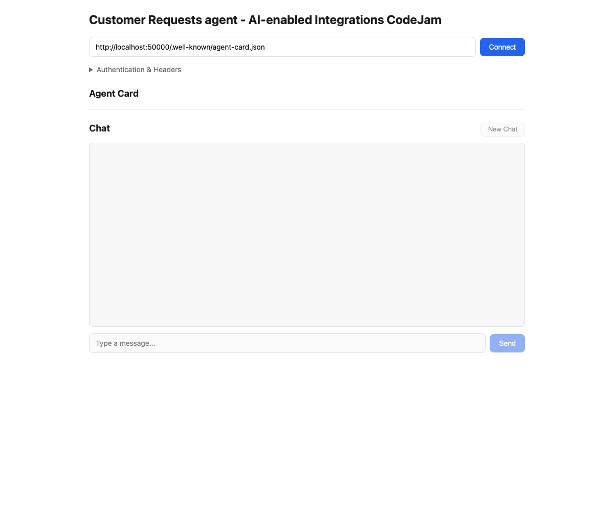

# Customer Request Agent

An AI agent that autonomously handles customer requests via MCP-exposed tools

## Overview

Uses A2A Protocol, LangGraph, LiteLLM, and SAP Cloud SDK.

## Structure

- `app/main.py` - A2A server entry
- `app/agent_executor.py` - Request handling
- `app/agent.py` - Agent logic

## Setup

### Virtual environment

```bash
cd app
python -m venv .venv
source .venv/bin/activate   # Windows: .venv\Scripts\activate
pip install -r ../requirements.txt
```

### Environment variables

Create `app/.env` (copy from `app/.env.example` if present) with:

| Variable | Description |
| --- | --- |
| `LITELLM_PROVIDER` | LLM provider (`sap` for SAP AI Core) |
| `AICORE_CLIENT_ID` | SAP AI Core service client ID |
| `AICORE_CLIENT_SECRET` | SAP AI Core service client secret |
| `AICORE_AUTH_URL` | OAuth token endpoint URL |
| `AICORE_BASE_URL` | SAP AI Core API base URL |
| `AICORE_RESOURCE_GROUP` | AI Core resource group |
| `IBD_TESTING` | Set to `1` to enable test mode |
| `INVOKE_LIVE_MCP` | Set to `1` to invoke live MCP tools |

Example `app/.env`:

```dotenv
LITELLM_PROVIDER="sap"

AICORE_CLIENT_ID=<your-client-id>
AICORE_CLIENT_SECRET=<your-client-secret>
AICORE_AUTH_URL=https://<subdomain>.authentication.<region>.hana.ondemand.com/oauth/token
AICORE_BASE_URL=https://api.ai.prod.<region>.aws.ml.hana.ondemand.com
AICORE_RESOURCE_GROUP="<your-resource-group>"

IBD_TESTING=1
INVOKE_LIVE_MCP=1
```

## Running

Start the agent server on port `50000`:

```bash
cd app
source .venv/bin/activate
python main.py --port 50000
```

Or via environment variables:

```bash
PORT=50000 python main.py
```

The server starts at `http://localhost:50000`. The A2A agent card is available at `http://localhost:50000/.well-known/agent-card.json`.

## Web UI

A very simple built-in chat UI, inspired by the A2A Inspector, is served at `http://localhost:50000/ui`. It lets you connect to the agent, inspect the agent card, and send messages directly in the browser.



## Event-triggered mode (advanced event mesh)

The agent can also be triggered by events from SAP Integration Suite, advanced event mesh (AEM), in addition to
A2A HTTP requests. This is **off by default** and controlled by a single flag:

| Variable | Description |
| --- | --- |
| `ENABLE_EVENTING` | `1` = connect to the AEM broker over AMQP 1.0 and consume events. `0`/unset = plain A2A HTTP server only, no broker connection. |
| `AEM_AMQP_HOST` / `AEM_AMQP_PORT` | AMQP host and port (`5671`) from the broker's *Connect → AMQP* section. |
| `AEM_AMQP_USERNAME` / `AEM_AMQP_PASSWORD` | AMQP credentials (used for both consuming and publishing). |
| `AEM_AMQP_QUEUE_NAME` | Durable queue the agent consumes from. It must be subscribed to the request topic `altura/customer-request-agent/request/v1` on the broker. |
| `AEM_AMQP_TLS_VERIFY` | `0` to skip TLS peer verification (dev only). |
| `AEM_RESPONSE_TOPIC` | Topic the agent publishes its response CloudEvent to (over the same AMQP connection). |

When enabled, the consumer runs as a background task inside the same process as the A2A server (one container).
Each incoming event is a CloudEvents 1.0 envelope whose `data.message` is a free-text chat request — exactly
what a user would type in the chat UI. The agent runs it and publishes its answer to `AEM_RESPONSE_TOPIC` over
the same AMQP connection (no separate REST endpoint or credentials).

> Setup: the consumed queue (`AEM_AMQP_QUEUE_NAME`) must be subscribed to the request topic
> `altura/customer-request-agent/request/v1` so that request events routed to that topic land on the queue.

**Incoming request event:**

```json
{
  "specversion": "1.0",
  "type": "com.altura.customer-request-agent.request.v1",
  "source": "/some-event-producer",
  "id": "9a1c1e2d-6b7f-4a1e-8c2a-2f0d0b1e3a4c",
  "time": "2026-09-22T10:15:00Z",
  "datacontenttype": "application/json",
  "data": { "message": "Get me the latest service requests for ai-integrations-000" }
}
```

**Outgoing response event** (published to `AEM_RESPONSE_TOPIC`):

```json
{
  "specversion": "1.0",
  "type": "com.altura.customer-request-agent.response.v1",
  "source": "/customer-request-agent",
  "id": "2b3d4f5a-1122-4c33-9d44-556677889900",
  "time": "2026-09-22T10:15:04Z",
  "datacontenttype": "application/json",
  "data": {
    "context_id": "b7e6c0a2-3f10-4d9b-9a55-0c2f1e4d8a71",
    "message": "Here are the latest service requests for ai-integrations-000: ..."
  }
}
```

> Note: event-triggered runs have no per-user JWT, so tool calls run without an end-user token. The
> customer-request MCP server (no auth) and the service-locator MCP (client credentials) still work.
